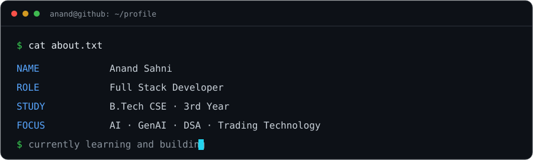
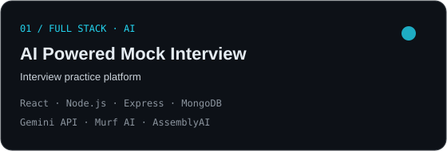
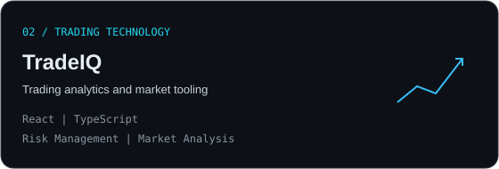
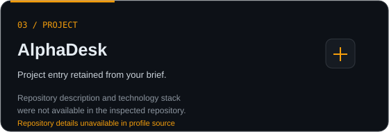
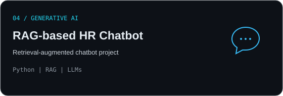



 

  
  

## `whoami`

  

I build full stack applications and explore how AI can make useful products more capable. My current focus spans web development, generative AI, problem solving, and trading technology.

## Technology stack

**Programming languages**

   

**Frontend**

  

**Backend**

 

**Databases**

 

**AI & machine learning**

 

**Developer tools**

  

## Selected work

<table>
  <tr>
    <td width="50%"></td>
    <td width="50%"></td>
  </tr>
  <tr>
    <td width="50%"></td>
    <td width="50%"></td>
  </tr>
</table>

Project repository links were not present in the inspected profile source, so no repository URLs or live demos are listed here.

## GitHub activity

 

 

## Contribution snake

<picture>
  <source media="(prefers-color-scheme: dark)" srcset="https://raw.githubusercontent.com/anand-sahnix/anand-sahnix/output/github-contribution-grid-snake-dark.svg" />
  <source media="(prefers-color-scheme: light)" srcset="https://raw.githubusercontent.com/anand-sahnix/anand-sahnix/output/github-contribution-grid-snake.svg" />
  
</picture>

## Connect

Build with intent | Learn continuously | Ship thoughtfully

